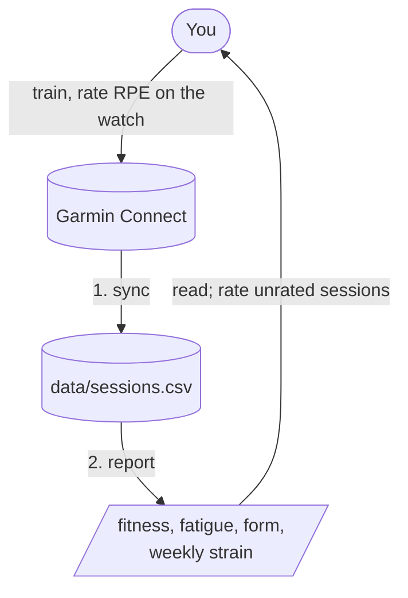

# coach

Training log: syncs sessions from Garmin and reports fitness, fatigue and form, so training can be moderated by fatigue. Vocabulary: [GLOSSARY.md](GLOSSARY.md).

## Main cycle

Run from the repo root:



```bash
source coach/.env && python3 -m coach.sync   # 1. sync new and edited sessions from Garmin into data/sessions.csv
python3 -m coach.report                     # 2. daily fitness/fatigue/form, weekly load/monotony/strain
```

Rate every session on the watch (its "Perceived Effort" prompt after each session). Load is RPE x minutes, so an unrated session adds no load and fatigue reads lower than it is; the report lists unrated sessions so you can rate them on Garmin and re-sync. Record combined training (e.g. run then strength training) as separate sessions, one per type, and martial arts under a dedicated watch profile rather than "Other".

The numbers describe your training; they don't predict injury or overtraining. Read them alongside sleep, HRV and how you feel.

## Layout

```
sync.py, report.py   # CLI entry points: python3 -m coach.<name>, from the repo root; sync_sessions / render_report hold the testable logic
core/        # domain logic: sessions (the log), load (track_form daily, measure_weekly_strain weekly)
connectors/  # external services: garmin.py (login, download_sessions; Garmin's JSON stays inside)
tests/       # run from the repo root: python3 -m pytest -q
data/        # personal data, git-ignored (below)
notes/       # free-form .md notes, git-ignored; the scripts ignore them
```

`core` never imports `connectors`; only the CLIs wire the two together. Paths here are relative to `coach/`.

## data/

- `sessions.csv` — one row per session: `garmin_id, date, type, duration_min, rpe, avg_hr`. `date` is the local start date, `type` Garmin's `typeKey` verbatim, `duration_min` elapsed time (rests included), `rpe` 1-10 or empty when unrated. `avg_hr` is stored but not used: load is session-RPE for every type, so all types share one scale.
- `.garmin_tokens/` — cached Garmin login tokens.

## sync.py

`python3 -m coach.sync [--since YYYY-MM-DD]`. With an empty log it syncs the last 90 days; afterwards it re-syncs from 3 days before the latest stored session, so RPE added on Garmin after a sync is picked up. Rows are keyed by Garmin id: re-syncing replaces a row, never duplicates it. Use `--since` to reach further back, e.g. after editing an old session on Garmin. Sessions deleted on Garmin stay in the log. A session whose type isn't listed in `Type` (`core/sessions.py`) aborts the whole sync, naming the typeKey: add it to `Type` and re-sync.

## report.py

`python3 -m coach.report [--days 14] [--weeks 8]`. Reads `data/sessions.csv` only.

- **Daily** (last `--days`): load, fatigue (ATL, 7-day weighted average of daily load), fitness (CTL, 42-day), form (TSB = yesterday's fitness − yesterday's fatigue). Rest days count as zero load. Both averages start at the mean daily load of the first 28 days; the first 42 days are marked `calibrating` and are not yet trustworthy.
- **Weekly** (last `--weeks`, ISO weeks): sessions, minutes and load per type; total load; monotony (mean ÷ standard deviation of the week's daily loads; above about 2 means too few easy days); strain (weekly load × monotony); the unrated sessions, by date and type. The current week counts its days so far.

## Garmin setup

Sync uses the unofficial [garminconnect](https://github.com/cyberjunky/python-garminconnect) library (pinned 0.3.2), which can break when Garmin changes its site.

1. Create `coach/.env` with `export GARMIN_EMAIL=...` and `export GARMIN_PASSWORD=...`.
2. Install the library if your `python3` lacks it: `pip install garminconnect==0.3.2`, or run sync as `uv run --with garminconnect==0.3.2 -m coach.sync`.
3. The first sync prompts for an MFA code if your account has one, then caches tokens in `data/.garmin_tokens/`; later runs reuse them.
