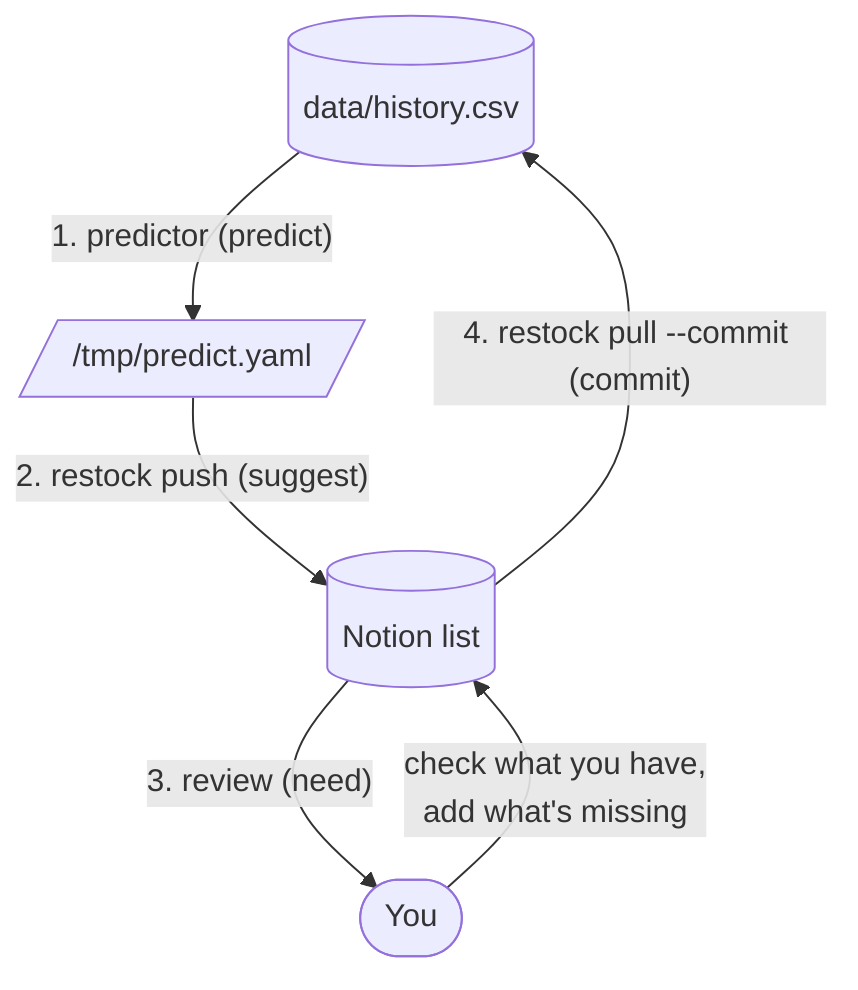

# food

Grocery tracker: reads a Notion shopping list, predicts what will be needed next. Vocabulary: [GLOSSARY.md](GLOSSARY.md).

## Main cycle

Run each step from the repo root as `python3 -m food.<cmd>`, in order:



Step 3 matters: your corrections become the next round's training data. Beware the feedback loop: rubber-stamping predictions teaches the model its own echoes. Actually inventory the fridge.

## Layout

```
restock.py, predictor.py   # CLI entry points: python3 -m food.<name>, from the repo root
core/        # domain logic: catalogue, history, shopping_list, prediction, model
connectors/  # external services: notion.py
tests/       # run from the repo root: python3 -m pytest -q
data/        # personal data, git-ignored (below)
notes/       # free-form .md notes, e.g. recipes, git-ignored; the scripts ignore them
```

`core` never imports `connectors`; only the CLIs (`restock.py`, `predictor.py`) wire the two together. Paths here are relative to `food/`; run commands from the repo root.

## data/

Personal data lives in `data/` (git-ignored), kept apart from the code:

- `catalogue.yaml` — item catalogue (canonical names, aliases, active flag).
- `history.csv` — history: one list entry (item, date, need) per item per commit.

## restock.py

Syncs the Notion shopping list with history. Run it as `python3 -m food.restock <subcommand>`; a subcommand is required.

Pulled labels are matched against `data/catalogue.yaml`:

| Item type | data/history.csv | side effect |
|-----------|----------------|-------------|
| active   | appended (with `--commit`) | — |
| inactive | nothing written | abort; reactivate or remove from Notion, then re-run `pull` |
| unknown  | nothing written | stubs written to `/tmp/catalogue_stubs.yaml`; move into `data/catalogue.yaml`, then re-run `pull` |
| duplicate | nothing written | abort; several boxes resolve to one item, so its need is ambiguous. Keep one box on Notion, then re-run `pull` |
| missing (active, no box) | nothing written | abort; every active item must be on the list. Add its box on Notion or set `active: false`, then re-run `pull` |

`data/catalogue.yaml` is never written by the script (except on first-run creation). Never delete entries — `data/history.csv` references canonical names. Use `active: false` to retire an item.

### Subcommands

- `pull` — fetch → resolve → dry run: prints how many rows it would append, writes nothing. Aborts on unknown/inactive/duplicate/missing.
- `pull --commit` — same, but commits the list to history, dated today.
- `push` — read `/tmp/predict.yaml` and suggest those items: untick their boxes on Notion. Aborts, listing them, if any item has several boxes (pull would refuse it) or any predicted item lacks a checkbox.
- `tick-all` — reset: tick every box on Notion. No history write. Leaves a blank slate to untick what you need to buy.

There is no snapshot of the fetched page: after fixing `catalogue.yaml`, re-run `pull`. It fetches the live page again and stamps today's date.

### Temp files

| File | Written by | Consumed by |
|------|-----------|-------------|
| `/tmp/catalogue_stubs.yaml`  | `pull` (unknown-item stubs) | manual edit → `data/catalogue.yaml` |
| `/tmp/predict.yaml`| `predictor.py`     | `push` |

## Notion setup

1. Create an integration at [notion.so/my-integrations](https://www.notion.so/my-integrations); copy the token.
2. On your grocery page → `...` → **Connections** → add the integration.
3. Copy the page ID from the URL (`notion.so/<title>-<PAGE_ID>`).
4. Export the token: `export NOTION_FOOD_PAGE_TOKEN=ntn_...` (add to your shell rc to persist). Likewise export the page id: `export NOTION_FOOD_PAGE_ID=...` (both live in `food/.env`; `source food/.env` before running).

The page should contain to-do checkboxes (`/todo`), nested under headings/toggles is fine. Item name = checkbox text; a trailing number (`eggs 2`) is a note for the shop and is ignored (one row). Check a box to mark "already have it" (`need: false`).

## Predictive model (core/model.py, CLI: predictor.py)

Per-item binary need given today's date and history. Active items only. Each `(item, date)` row's features use only history strictly before `date`.

Evaluation is leave-one-commit-out CV (random splits would leak commit-level context).

### Model choice by data size

- **~500 rows:** logistic regression. Consider bigger models for 10K+ rows

### Running

Needs numpy 1.26.4, pandas 2.1.1, scikit-learn 1.3.1 and pyyaml. If your `python3` lacks them: `uv run --with numpy==1.26.4 --with pandas==2.1.1 --with scikit-learn==1.3.1 -m food.predictor`.

```bash
python3 -m food.predictor              # default top-N = 25
python3 -m food.predictor --top-n 30
```
